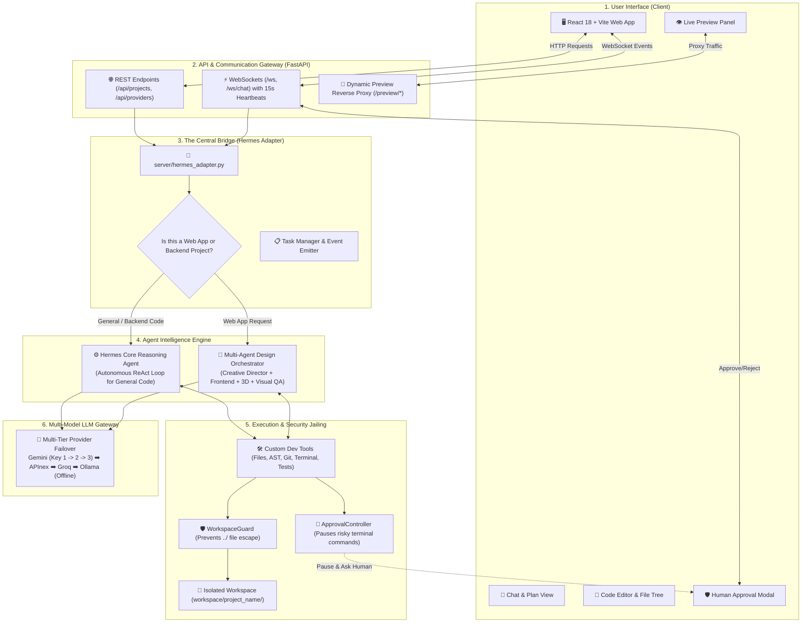
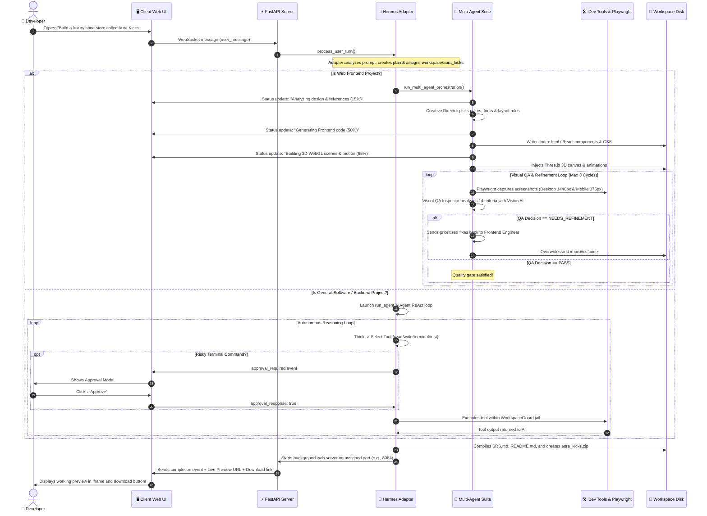
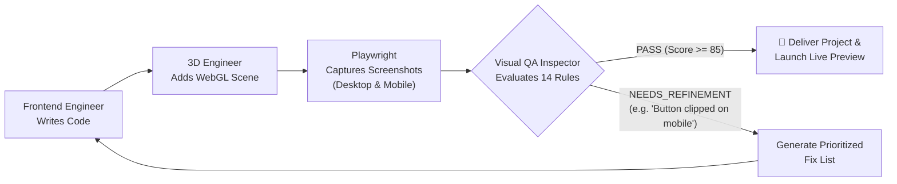
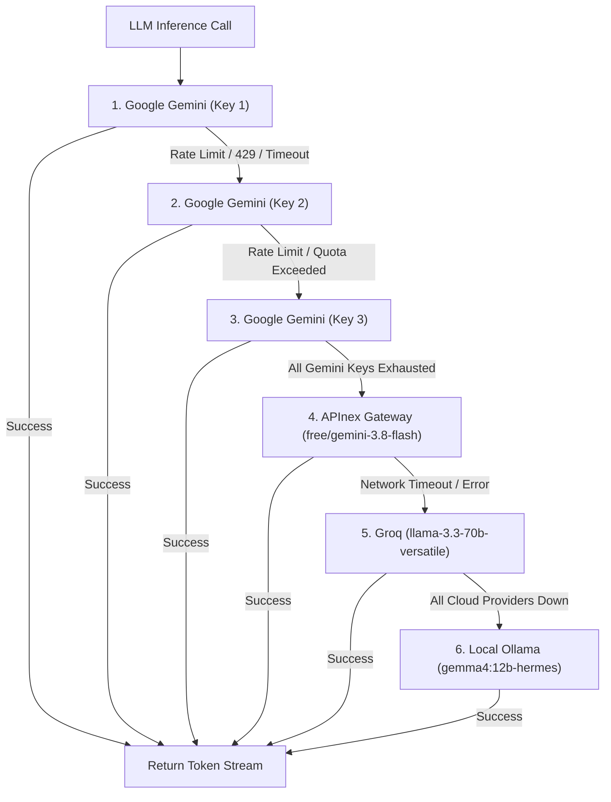

# 🏛️ Hermes Project: Complete Architecture, Structure & Instruction Flows

> **Target Audience**: Incoming Engineering Teams, Product Managers, and Developers.  
> **Goal**: A complete, friendly, plain-English breakdown of what the Hermes platform is, how data and instructions flow through it, and what every background agent is doing behind the scenes.

---

## 📑 Table of Contents
1. [Executive Summary (What is Hermes?)](#1-executive-summary-what-is-hermes)
2. [The Big Picture: System Architecture & Structure Flow](#2-the-big-picture-system-architecture--structure-flow)
3. [End-to-End Instruction Flow (From Prompt to Working App)](#3-end-to-end-instruction-flow-from-prompt-to-working-app)
4. [Deep Dive: What Each Agent Does in the Background](#4-deep-dive-what-each-agent-does-in-the-background)
   - [The Orchestrator (The Conductor / Project Manager)](#agent-1-the-orchestrator-the-conductor--project-manager)
   - [Reference Inspector Agent (The Style Detective)](#agent-2-reference-inspector-agent-the-style-detective)
   - [Creative Director Agent (The Chief Designer)](#agent-3-creative-director-agent-the-chief-designer)
   - [Frontend Engineer Agent (The Lead Web Builder)](#agent-4-frontend-engineer-agent-the-lead-web-builder)
   - [Motion & 3D Engineer Agent (The 3D Artist & Animator)](#agent-5-motion--3d-engineer-agent-the-3d-artist--animator)
   - [Visual QA Inspector Agent (The Strict Quality Auditor)](#agent-6-visual-qa-inspector-agent-the-strict-quality-auditor)
   - [Core Hermes Reasoning Agent (The Backend / Fullstack Coder)](#agent-7-core-hermes-reasoning-agent-the-backend--fullstack-coder)
5. [The Autonomous Refinement Loop (Closed-Loop Quality Control)](#5-the-autonomous-refinement-loop-closed-loop-quality-control)
6. [Security, Sandboxing & Human Approval](#6-security-sandboxing--human-approval)
7. [Smart LLM Fallback & Resilience (Why Hermes Never Crashes)](#7-smart-llm-fallback--resilience-why-hermes-never-crashes)
8. [Live Preview & Instant Deliverables System](#8-live-preview--instant-deliverables-system)
9. [Developer Guide: Codebase Map & Directory Structure](#9-developer-guide-codebase-map--directory-structure)
10. [How to Run & Test the Application](#10-how-to-run--test-the-application)

---

## 1. Executive Summary (What is Hermes?)

Think of **Hermes** as an **autonomous software engineering agency inside your computer**.

Normally, building a modern application requires multiple specialists:
- A **Product Manager** to scope requirements.
- A **Designer** to pick colors, typography, and layout.
- A **Frontend Engineer** to write HTML, CSS, JavaScript, or React code.
- A **3D/Motion Specialist** to add smooth animations and interactive models.
- A **QA Tester** to open the site in different screen sizes and point out visual defects.

**Hermes does all of this automatically.** When a user enters a plain-English request (such as *"Create a luxury Italian restaurant website called Osteria Terra"* or *"Build a Python CLI tool with automated tests"*), Hermes:
1. Understands the intent and decides the best technical approach.
2. Coordinates specialized AI agents in the background.
3. Generates complete, production-ready code in an isolated workspace.
4. Spins up a headless browser to take real screenshots and visually verify the result.
5. If anything looks wrong, automatically refines and fixes the code.
6. Launches a live preview web server and packages a ready-to-download ZIP file.

---

## 2. The Big Picture: System Architecture & Structure Flow

The platform is split into five clean, decoupled layers. Here is how they connect:



### Layer Breakdown
| Layer | Main Files | Responsibility |
| :--- | :--- | :--- |
| **1. Client UI** | `client/src/App.jsx`, `ChatPanel.jsx`, `FileTree.jsx`, `FileViewer.jsx` | Beautiful modern interface (React + Vite) with 3-pane resizable layout, live chat, code editor, and live preview. |
| **2. API Gateway** | `server/main.py` | FastAPI server managing real-time WebSocket communication, keepalive heartbeats, and dynamic reverse-proxying. |
| **3. Hermes Adapter** | `server/hermes_adapter.py` | The central brain. Parses user intent, classifies project type, dispatches agents, and manages security. |
| **4. Agent Engines** | `server/agents/` | Houses the specialized multi-agent design pipeline and the core Hermes autonomous problem solver. |
| **5. Security & Sandbox** | `server/security/`, `server/tools/` | Ensures the AI cannot write files outside its designated folder or run dangerous terminal commands without permission. |
| **6. LLM Gateway** | `server/agents/provider_manager.py` | Smart failover system that rotates multiple Gemini keys, APInex, Groq, and Ollama to guarantee 100% uptime. |

---

## 3. End-to-End Instruction Flow (From Prompt to Working App)

When a developer types a prompt into the chat box, here is the exact sequence of events that takes place:



---

## 4. Deep Dive: What Each Agent Does in the Background

The secret to Hermes' high-quality output is that **tasks are divided among specialized agents** rather than asking a single prompt to do everything. Each agent has one job and does it to perfection:

```text
┌─────────────────────────────────────────────────────────────────────────────┐
│                       MULTI-AGENT WORKFORCE OVERVIEW                        │
│                                                                             │
│   ┌─────────────────────────────────────────────────────────────────────┐   │
│   │ 1. PROMPT REFERENCE PARSER                                          │   │
│   │    Extracts user brief, isolates screenshots, detects brand & domain│   │
│   └──────────────────────────────────┬──────────────────────────────────┘   │
│                                      ▼                                      │
│   ┌─────────────────────────────────────────────────────────────────────┐   │
│   │ 2. CREATIVE DIRECTOR AGENT                                          │   │
│   │    Design archetype, color tokens, Google Fonts, layout grid        │   │
│   └──────────────────────────────────┬──────────────────────────────────┘   │
│                                      ▼                                      │
│   ┌─────────────────────────────────────────────────────────────────────┐   │
│   │ 3. FRONTEND ENGINEER AGENT                                          │   │
│   │    Vite+React or semantic HTML5, CSS custom properties, UI modules  │   │
│   └──────────────────────────────────┬──────────────────────────────────┘   │
│                                      ▼                                      │
│   ┌─────────────────────────────────────────────────────────────────────┐   │
│   │ 4. MOTION & 3D ENGINEER AGENT                                       │   │
│   │    Three.js canvas, GLTF 3D models, smooth camera, canvas fallback  │   │
│   └──────────────────────────────────┬──────────────────────────────────┘   │
│                                      ▼                                      │
│   ┌─────────────────────────────────────────────────────────────────────┐   │
│   │ 5. VISUAL QA INSPECTOR AGENT (Playwright + Vision AI)               │   │
│   │    Audits 14 visual rules. If defects found ➡️ loops back to step 3 │   │
│   └─────────────────────────────────────────────────────────────────────┘   │
└─────────────────────────────────────────────────────────────────────────────┘
```

---

### Agent 1: The Orchestrator (The Conductor / Project Manager)
- **File**: [`server/agents/orchestrator.py`](server/agents/orchestrator.py)
- **What it does**:
  - Acts as the project manager overseeing the entire workflow.
  - Takes the user prompt, creates the project directory, and initiates the pipeline.
  - Sends real-time progress percentages (15%, 30%, 50%, 65%, 80%, 100%) to the user's screen.
  - Saves intermediate state in `.generation_state.json` so work is never lost.
  - Controls the **refinement loop**: if the QA agent reports issues, the Orchestrator commands the engineers to fix them.

---

### Agent 2: Reference Inspector Agent (The Style Detective)
- **File**: [`server/agents/reference_inspector.py`](server/agents/reference_inspector.py)
- **What it does**:
  - If the user attached screenshot references or URLs (e.g., *"Make it look like Apple's website"* or an uploaded image), this agent inspects them using Vision AI.
  - Extracts the **visual mood**, **color schemes**, **spacing density**, and **component layout patterns**.
  - Ensures the user's requested brand is built, while borrowing the high-end aesthetic from the reference image.

---

### Agent 3: Creative Director Agent (The Chief Designer)
- **File**: [`server/agents/creative_director_agent.py`](server/agents/creative_director_agent.py)
- **What it does**:
  - Sets the visual identity and aesthetic rules before a single line of code is written.
  - **Archetype Selection**: Selects a distinctive design personality tailored to the industry:
    - *Minimalist Luxury / Editorial* for luxury ateliers and fashion.
    - *Dark Cyberpunk / Bento Grid* for developer tools and streaming data.
    - *Warm Organic Sanctuary* for culinary and artisanal restaurants.
    - *High-Energy Studio* for sports and footwear.
  - **Design Tokens**: Computes harmonious color palettes (primary, accents, dark background, borders) with guaranteed WCAG AA high contrast.
  - **Typography**: Picks professional Google Fonts (e.g., Outfit, Plus Jakarta Sans, Playfair Display) instead of boring browser defaults.
  - **Anti-AI-Slop Rules**: Strictly bans generic AI tropes like purple-to-blue neon gradients, random emoji icons (👟🛒⭐), and plain white rectangles.

---

### Agent 4: Frontend Engineer Agent (The Lead Web Builder)
- **File**: [`server/agents/frontend_engineer_agent.py`](server/agents/frontend_engineer_agent.py)
- **What it does**:
  - Writes the complete, working code for the web application.
  - **React Bits vs HTML5**: If the user requested React or modern animated components, it invokes [`react_bits_generator.py`](server/agents/react_bits_generator.py) to spin up a full Vite + React project with interactive animated backgrounds, spotlight cards, and kinetic typography.
  - **Domain Specialist Engines**: Uses rich, domain-specific templates for restaurants, fashion ateliers, sculptural furniture, real estate, and devtools to guarantee realistic data, genuine copy, and functional features (working carts, search filters, reservation modals).
  - **Professional Vector Icons**: Injects clean, hand-crafted Lucide SVG icons instead of emojis.
  - **Full Interactivity**: Writes real JavaScript for cart calculations, filter toggles, mobile hamburger menus, and modal dialogs.

---

### Agent 5: Motion & 3D Engineer Agent (The 3D Artist & Animator)
- **File**: [`server/agents/motion_3d_engineer_agent.py`](server/agents/motion_3d_engineer_agent.py)
- **What it does**:
  - Brings the webpage to life with dynamic motion and 3D graphics.
  - **WebGL Three.js Scenes**: Mounts interactive 3D viewports in the hero section.
  - **Interactive Lighting & Camera Controls**: Adds smooth orbit controls, mouse-follow parallax, and ambient studio lighting.
  - **Safe Fallback**: If WebGL is not supported or 3D models fail to load, automatically provides a sleek 2D animated canvas (particle net, gradient mesh, or mathematical waveforms) so the screen never looks broken.

---

### Agent 6: Visual QA Inspector Agent (The Strict Quality Auditor)
- **File**: [`server/agents/visual_qa_inspector_agent.py`](server/agents/visual_qa_inspector_agent.py)
- **What it does**:
  - This is the quality police of Hermes.
  - Uses **Playwright** (a headless Chrome browser) to open the generated project and take real high-resolution screenshots at two critical viewports:
    - **Desktop**: 1440 × 900 px
    - **Mobile**: 375 × 812 px
  - Sends these screenshots to the Multimodal Vision AI model to audit **14 distinct criteria**:
    1. *Layout Balance & Grid Alignment*
    2. *Typography Hierarchy & Line Spacing*
    3. *Color Contrast (WCAG AA Compliance >= 4.5:1)*
    4. *Mobile Responsiveness (No horizontal overflow)*
    5. *Interactive State Indicators (Hover, Focus rings)*
    6. *Visual Polish & Elevation*
    7. *Semantic Product Fidelity* (Verifying that a shoe store actually shows shoes and not generic geometric cubes!)
    8. *Whitespace Scale & Padding*
    9. *Iconography Consistency*
    10. *Navigational Usability*
    11. *Asset Loading Health (No 404 broken image icons)*
    12. *Hero Section Dominance*
    13. *Footer Completeness*
    14. *Overall Craft & WOW Factor*
  - **The Decision**: Issues a verdict:
    - `PASS` (Grade >= 85%): Ready for delivery!
    - `NEEDS_REFINEMENT`: Compiles a list of prioritized fixes and sends them back to the engineers.
    - `BLOCKED`: If a critical failure cannot be recovered, alerts the user.

---

### Agent 7: Core Hermes Reasoning Agent (The Backend / Fullstack Coder)
- **File**: [`hermes-agent/run_agent.py`](hermes-agent/run_agent.py)
- **What it does**:
  - When the user asks for Python code, APIs, CLI apps, bug fixes, or database tools, this engine takes over.
  - Uses the **ReAct pattern (Reason + Act)**:
    1. **Think**: Evaluates the current state of the workspace.
    2. **Act**: Selects and calls a tool (e.g. `read_file`, `write_file`, `execute_command`, `run_tests`).
    3. **Observe**: Examines the terminal output or test results.
    4. **Reflect**: If tests failed, fixes the code and re-runs until all tests pass!

---

## 5. The Autonomous Refinement Loop (Closed-Loop Quality Control)

Here is how Hermes catches its own mistakes before the user ever sees them:



- Up to **3 automatic refinement cycles** run in the background.
- If a mobile layout has text overlapping or an image fails to render, the Visual QA inspector spots it in the screenshot, specifies the exact CSS selector to fix, and the Frontend Engineer corrects it seamlessly.

---

## 6. Security, Sandboxing & Human Approval

Because Hermes can execute code and terminal commands, security is designed with **zero-trust guardrails**:

```text
┌─────────────────────────────────────────────────────────────────────────────┐
│                           SECURITY SANDBOX LAYERS                           │
│                                                                             │
│   [ Tool Request ]                                                          │
│          │                                                                  │
│          ▼                                                                  │
│   ┌─────────────────────────────────────────────────────────────────────┐   │
│   │ LAYER 1: WorkspaceGuard                                             │   │
│   │ Resolves every path. Path escaping with `../` or `/etc` is BLOCKED. │   │
│   └──────────────────────────────────┬──────────────────────────────────┘   │
│                                      ▼                                      │
│   ┌─────────────────────────────────────────────────────────────────────┐   │
│   │ LAYER 2: Command Risk Classifier (ApprovalController)               │   │
│   │  - Read-Only (ls, cat, git status) ➡️ Runs automatically            │   │
│   │  - Dangerous (rm, kill, git reset)  ➡️ PAUSES & Asks Human in UI    │   │
│   └──────────────────────────────────┬──────────────────────────────────┘   │
│                                      ▼                                      │
│   ┌─────────────────────────────────────────────────────────────────────┐   │
│   │ LAYER 3: Isolated Execution (Docker Container / Bounded Process)    │   │
│   │ Production fail-closed isolation ensures host system safety.        │   │
│   └─────────────────────────────────────────────────────────────────────┘   │
└─────────────────────────────────────────────────────────────────────────────┘
```

1. **WorkspaceGuard** ([`server/security/workspace_guard.py`](server/security/workspace_guard.py)):
   - Every file read, write, or patch is strictly jailed inside the project folder (`workspace/<project_name>/`).
   - If an agent attempts to access `/etc/passwd` or `../../secret.env`, the action is blocked instantly with a security exception.
2. **ApprovalController** ([`server/security/approval_controller.py`](server/security/approval_controller.py)):
   - Distinguishes safe read-only operations from destructive commands.
   - If an agent attempts to run `rm -rf`, delete files, or modify system binaries, execution pauses, and an **Approval Modal** pops up on the user's screen asking: *"The agent wants to run `rm test.py`. Do you approve?"*
3. **ContainerRunner** ([`server/security/container_runner.py`](server/security/container_runner.py)):
   - Allows running commands inside ephemeral Docker containers so code executes safely away from the host machine.

---

## 7. Smart LLM Fallback & Resilience (Why Hermes Never Crashes)

AI APIs occasionally run out of quota (HTTP 429), encounter server errors (HTTP 500), or experience network timeouts. 

Hermes features an **automated, multi-tier provider failover chain** managed by [`server/agents/provider_manager.py`](server/agents/provider_manager.py):



### Key Provider Resilience Rules
- **Authentication Failures (401/403)**: Marked permanently invalid so the system does not waste time retrying bad credentials.
- **Recoverable Errors (429 Rate Limits / 5xx / Timeouts)**: Immediately triggers smooth failover to the next provider in the chain.
- **Automatic Cooldown Recovery**: Once a primary key's rate limit cooldown period expires, Hermes automatically restores it to primary status for the next request.
- **15-Second WebSocket Keepalive**: Background heartbeat context sends ping packets every 15 seconds to prevent browser timeouts during heavy code generation.

---

## 8. Live Preview & Instant Deliverables System

Once the agents finish building the application:

1. **Background Server Port Allocation**:
   - [`server/project/project_server_manager.py`](server/project/project_server_manager.py) assigns an available background port from the pool (`8080–8099`) and boots a lightweight web server serving the project files.
2. **Dynamic Reverse Proxy**:
   - The user does not need to configure ports or IP addresses.
   - The FastAPI backend provides a reverse proxy route at `/preview/{project_name}/`.
   - It automatically intercepts the HTML, injects `<base href="/preview/{project_name}/">`, and rewrites relative assets (CSS, JS, images) so everything loads perfectly inside the UI preview iframe.
3. **Automated Documentation**:
   - Automatically writes a professional **`SRS.md`** (Software Requirements Specification) detailing features, tech stack, and user flows.
   - Automatically writes a clean **`README.md`** with installation and running instructions.
4. **Instant ZIP Archive**:
   - Bundles the entire project directory into `workspace/{project_name}.zip` and generates a direct one-click download link in the chat interface.

---

## 9. Developer Guide: Codebase Map & Directory Structure

Here is where all major components live in the repository:

```text
Hermes Project/
├── client/                                 # 🖥️ FRONTEND (React 18 + Vite)
│   ├── src/
│   │   ├── App.jsx                         # Main dashboard layout (Chat, Editor, Preview)
│   │   ├── components/
│   │   │   ├── ChatPanel.jsx               # Streaming chat, tool progress, live feedback
│   │   │   ├── FileTree.jsx                # Directory browser for workspace files
│   │   │   ├── FileViewer.jsx              # Syntax-highlighted code editor
│   │   │   ├── PlanView.jsx                # Multi-phase milestone progress tracker
│   │   │   ├── ApprovalModal.jsx           # Human-in-the-loop safety prompt
│   │   │   └── ActivityPanel.jsx           # Real-time event and terminal log viewer
│   │   └── index.css                       # Global design system & theme variables
│   │
├── server/                                 # ⚡ BACKEND (FastAPI & Agent Engine)
│   ├── main.py                             # API server, WebSocket handlers & preview proxy
│   ├── hermes_adapter.py                   # Central adapter connecting UI to AI agents
│   │
│   ├── agents/                             # 🎨 MULTI-AGENT DESIGN SUITE
│   │   ├── orchestrator.py                 # MultiAgentOrchestrator pipeline manager
│   │   ├── creative_director_agent.py      # Aesthetics, design tokens & typography
│   │   ├── frontend_engineer_agent.py      # HTML/React layout & domain generators
│   │   ├── motion_3d_engineer_agent.py     # Three.js 3D viewport & WebGL animations
│   │   ├── visual_qa_inspector_agent.py    # 14-point visual QA & multimodal vision audit
│   │   ├── reference_inspector.py          # Visual screenshot & reference image analyzer
│   │   ├── react_bits_generator.py         # Vite + React + React Bits animated scaffold
│   │   ├── provider_manager.py             # Multi-key LLM failover & health manager
│   │   ├── llm_client.py                   # Multi-modal LLM communication client
│   │   └── schemas.py                      # Pydantic data schemas for agent messages
│   │
│   ├── tools/                              # 🛠️ CUSTOM DEVELOPER TOOLSET
│   │   ├── dev_file_tools.py               # Sandboxed file read/write/edit/search
│   │   ├── dev_terminal_tools.py           # Controlled shell execution
│   │   ├── dev_testing_tools.py            # Test suite runner & test discovery
│   │   ├── dev_git_tools.py                # Git status, diff, and commit helpers
│   │   ├── dev_ast_tools.py                # Abstract Syntax Tree symbol & impact analyzer
│   │   ├── dev_health_tools.py             # Project build & lint syntax auditor
│   │   └── dev_visual_qa_tools.py          # Playwright screenshot capture utility
│   │
│   ├── security/                           # 🛡️ SECURITY & SANDBOXING
│   │   ├── workspace_guard.py              # Path traversal protection
│   │   ├── approval_controller.py          # Human confirmation for dangerous commands
│   │   └── container_runner.py             # Docker container isolation runner
│   │
│   └── project/                            # 📦 PROJECT LIFECYCLE MANAGEMENT
│       ├── project_server_manager.py       # Port pool & background dev server manager
│       ├── project_analyzer.py             # Tech stack & manifest generator
│       └── structure_analyzer.py           # Directory hierarchy scanner
│
├── hermes-agent/                           # 🧠 CORE HERMES REASONING ENGINE
│   ├── run_agent.py                        # AIAgent conversational ReAct loop
│   └── tools/                              # Core Hermes tool dispatcher
│
├── workspace/                              # 📁 GENERATED PROJECTS OUTPUT
│   └── <project_name>/                     # Isolated projects built by the AI
│
└── docs/                                   # 📚 DOCUMENTATION DIRECTORY
    └── HERMES_PROJECT_EXPLANATION.md       # This comprehensive explanation document
```

---

## 10. How to Run & Test the Application

### 1. Starting the Backend Server
Make sure you are in the project root with your Python environment active:
```bash
python3 server/main.py
```
*The server will start on `http://127.0.0.1:8000`.*

### 2. Starting the Client Web UI
Open a second terminal window:
```bash
cd client
npm install
npm run dev
```
*Open `http://localhost:5173` in your browser.*

### 3. Running Automated Tests
Hermes includes a comprehensive test suite covering security, agents, tools, and failover:
```bash
# Run all core tests
pytest tests/

# Test provider failover resilience
pytest tests/test_gemini_integration.py
pytest tests/test_apinex_integration.py

# Test security sandboxing & path jail
pytest tests/test_security.py
```

---

## Summary Checklist for the Next Team

When taking over or extending the Hermes project:
1. **Adding a New Agent**: Create your agent class in `server/agents/`, inherit from `BaseAgent`, and register its execution step inside `server/agents/orchestrator.py`.
2. **Adding a New Dev Tool**: Add your tool method in `server/tools/`, then register its name and signature inside `server/hermes_adapter.py` in the `tool_specs` table.
3. **Modifying Visual QA Rules**: Edit the 14 inspection criteria in `server/agents/visual_qa_inspector_agent.py`.
4. **Adding an LLM Provider**: Register new models or API base endpoints in `server/agents/provider_manager.py`.

*Document authored for the engineering team. All architectural flows, agent roles, and security bounds are verified against the active codebase.*
