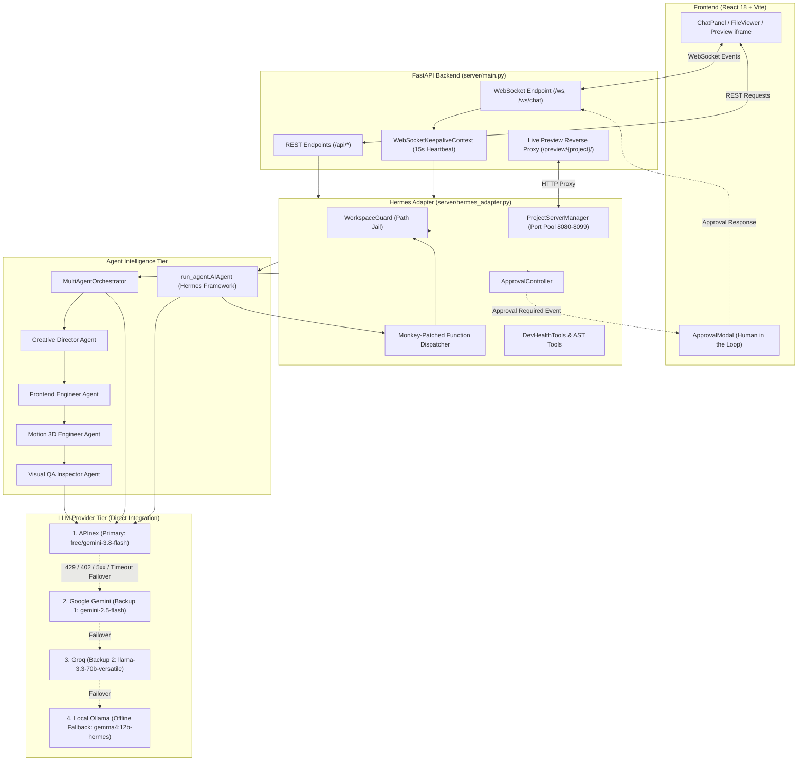

# Hermes Autonomous Software Development Platform
## Comprehensive Project Architecture Map

---

## 1. Executive Overview

**HermesProject** is an enterprise-grade autonomous software engineering platform designed to understand, architect, generate, test, debug, and preview complete multi-file applications. Built on top of the **NousResearch/hermes-agent** reasoning engine, HermesProject augments autonomous agent intelligence with:

1. **A Direct Multi-Provider LLM Tier**: Prioritizing **APInex** as the primary high-throughput gateway with automatic fallback to **Google Gemini**, **Groq**, and local **Ollama**.
2. **A Specialized Multi-Agent Design Orchestrator**: Coordinating Creative Director, Frontend Engineer, Motion 3D Engineer, and Visual QA Inspector agents for high-aesthetic web applications.
3. **A Dual-Interface Backend**: Providing both RESTful control endpoints and a persistent, low-latency WebSocket connection with keepalive heartbeats for streaming tool execution and tokens.
4. **Strict Security Jailing & Human-in-the-Loop Safeguards**: Workspace traversal guards, isolated Docker execution with production fail-closed policies, and approval modals for high-risk terminal actions.
5. **Zero-Configuration Live Previews & Bundling**: Dynamic background dev server management with automated proxy routing and instant ZIP exports.

---

## 2. Repository Structure

Below is the verified structural directory tree of the active workspace (`.`), omitting generated artifacts (`node_modules`, `dist`, `__pycache__`, `.DS_Store`):

```text
HermesProject/
├── .agents/                               # Workspace agent customization rules & skills
├── .env                                   # Active environment credentials (never committed)
├── .env.example                           # Canonical environment variable template
├── .gitignore                             # Version control exclusion rules
├── .project_manifest.json                 # Cached project structure metadata
├── .sessions_db.json                      # Persistent session registry
├── README.md                              # Project overview and quickstart guide
├── SRS.md                                 # Software Requirements Specification
├── main.py                                # Convenience entry point script
│
├── client/                                # React 18 + Vite Frontend Application
│   ├── index.html                         # Client HTML entry point
│   ├── package.json                       # Frontend dependencies (React, Lucide, Three.js)
│   ├── vite.config.js                     # Vite dev server and proxy config
│   └── src/
│       ├── main.jsx                       # Application bootstrapping & root render
│       ├── App.jsx                        # Main UI layout (chat, files, preview, approval)
│       ├── index.css                      # Global design system & theme styling
│       └── components/
│           ├── ChatPanel.jsx              # Streaming conversation, tool logs & markdown
│           ├── ApprovalModal.jsx          # Human-in-the-loop action approval modal
│           ├── FileTree.jsx               # Workspace directory hierarchy browser
│           ├── FileViewer.jsx             # Code viewer and syntax-highlighted editor
│           ├── PlanView.jsx               # Autonomous task planner & progress tracker
│           └── ActivityPanel.jsx          # Agent execution status & event timeline
│
├── server/                                # FastAPI Backend & Hermes Orchestration Engine
│   ├── main.py                            # FastAPI app, REST routes, WebSockets & preview proxy
│   ├── hermes_adapter.py                  # Core adapter bridging Hermes runtime & custom tools
│   ├── compat.py                          # Runtime compatibility and monkey patches
│   ├── requirements.txt                   # Backend Python dependencies
│   │
│   ├── agents/                            # Multi-Agent Design & LLM Integration Layer
│   │   ├── base_agent.py                  # Base class for specialized subagents
│   │   ├── llm_client.py                  # OpenAI-compatible multimodal LLM client
│   │   ├── orchestrator.py                # MultiAgentOrchestrator for web projects
│   │   ├── creative_director_agent.py     # Aesthetic direction, typography, design tokens
│   │   ├── frontend_engineer_agent.py     # HTML5/CSS3/JS responsive layout generator
│   │   ├── motion_3d_engineer_agent.py    # Three.js 3D viewport & animation synthesizer
│   │   ├── visual_qa_inspector_agent.py   # 14-dimension visual QA & semantic audit
│   │   ├── reference_inspector.py         # Multi-modal reference image analyzer
│   │   └── schemas.py                     # Pydantic schemas for agent contexts & specs
│   │
│   ├── tools/                             # Developer Toolset Registered into Hermes
│   │   ├── dev_file_tools.py              # Jailed read, write, patch, and search tools
│   │   ├── dev_terminal_tools.py          # Bounded command runner with container support
│   │   ├── dev_git_tools.py               # Repository status, diff, and revision tools
│   │   ├── dev_ast_tools.py               # Abstract syntax tree symbol & impact analysis
│   │   ├── dev_health_tools.py            # Project build, test, and lint health checks
│   │   ├── dev_testing_tools.py           # Test runner and related test discovery
│   │   ├── dev_review_tools.py            # Automated code review & change analyzer
│   │   ├── dev_visual_qa_tools.py         # Screenshot capture & headless browser tester
│   │   ├── creative_direction_engine.py   # Intent classification & color palette synthesis
│   │   ├── autonomous_art_director.py     # Production UX rules & aesthetic constraints
│   │   ├── component_discovery.py         # React/HTML component scanner
│   │   ├── asset_discovery.py             # Unsplash imagery, Khronos 3D models, Google fonts
│   │   └── product_intent_classifier.py   # Domain intent analyzer (e.g. ecommerce, dashboard)
│   │
│   ├── security/                          # Security Jailing & Approval Subsystem
│   │   ├── workspace_guard.py             # Strict path resolution & jail boundary guard
│   │   ├── container_runner.py            # Docker container isolation & fail-closed engine
│   │   └── approval_controller.py         # Human approval controller for high-risk commands
│   │
│   ├── project/                           # Project Introspection & Live Dev Servers
│   │   ├── project_detector.py            # Tech stack & language detection
│   │   ├── project_analyzer.py            # Project manifest & complexity metrics generator
│   │   ├── structure_analyzer.py          # Hierarchical directory representation
│   │   ├── dependency_analyzer.py         # Dependency manifest parsing (npm, pip)
│   │   └── project_server_manager.py      # Background server manager & port allocator
│   │
│   ├── tasks/                             # Task Planning & Event Subsystem
│   │   ├── task_manager.py                # Development phase planner & task tracking
│   │   ├── task_models.py                 # Pydantic models for plans and tasks
│   │   └── task_events.py                 # Standard event schema (`create_event`)
│   │
│   └── debug/                             # Self-Healing & Diagnostic Subsystem
│       └── error_memory.py                # Persistent error & solution registry
│
├── hermes-agent/                          # Core Hermes Agent Reasoning Submodule
│   ├── run_agent.py                       # AIAgent entry point & conversation loop
│   ├── providers/                         # Built-in provider registration system
│   ├── tools/                             # Core tool registry & execution dispatcher
│   └── plugins/
│       └── model-providers/               # Declarative Provider Plugins
│           ├── apinex/                    # APInex plugin profile (plugin.yaml, __init__.py)
│           ├── groq/                      # Groq plugin profile
│           ├── gemini/                    # Google Gemini plugin profile
│           └── ...                        # Extended provider catalog
│
├── tests/                                 # Automated Test Suite
│   ├── test_apinex_integration.py         # 14 APInex isolated unit & failover tests
│   ├── test_gemini_integration.py         # 8 Google Gemini regression tests
│   ├── test_phase1_verification.py        # Infrastructure & workspace guard checks
│   ├── test_phase2_intent_classification.py # Domain classification tests
│   ├── test_phase3_fallback_behavior.py   # Intent boilerplate & fallback tests
│   ├── test_phase4_production_readiness.py# State machine & lifecycle tests
│   ├── test_phase5_1_fail_closed_security.py # Docker fail-closed isolation tests
│   ├── test_phase6_verification.py        # Visual QA & 3D fidelity verification
│   ├── test_security.py                   # Path traversal & approval tests
│   ├── test_ast_tools.py                  # Code parsing & AST impact tests
│   ├── test_task_manager.py               # Task planning tests
│   └── ...                                # Comprehensive test catalog
│
├── scripts/                               # Operational & Automation Scripts
│   ├── test_apinex_live.py                # Non-destructive APInex live endpoint verification
│   ├── startup.sh                         # Unified application startup script
│   └── shutdown.sh                        # Process termination & cleanup script
│
├── docs/                                  # Technical & Architectural Documentation
│   ├── PROJECT_ARCHITECTURE.md            # This document: Comprehensive system map
│   ├── PROJECT_HEALTH_AUDIT.md            # Baseline quality audit and status report
│   ├── DEPLOYMENT_GUIDE.md                # Server deployment & hosting instructions
│   └── DOCKER_ISOLATION_ARCHITECTURE.md   # Container security specification
│
└── workspace/                             # Generated & Managed Projects Storage
    ├── 3d_shoes_ecommerce/                # Sample generated Three.js footwear project
    ├── luxury_ecommerce/                  # Sample generated luxury store
    └── ...                                # Additional user projects and archives
```

---

## 3. Application Architecture & Component Interactions

The architecture follows a layered, decoupled design separating presentation, API routing, agent orchestration, security jailing, and LLM providers.



### 3.1 Component Breakdown

#### A. Application Entry Point (`server/main.py`)
- **Framework**: FastAPI with full CORS enablement.
- **Static Mounting**: Automatically serves precompiled Vite production assets from `client/dist` at root `/`.
- **Sessions & State**: Backed by a persistent JSON database (`.sessions_db.json`).
- **Live Preview Proxy**: Routes requests to `/preview/{project_name}/{path}` by dynamically querying `ProjectServerManager` and transparently proxying requests to background web servers. Performs on-the-fly HTML base tag injection and asset path rewriting.

#### B. Hermes Agent Adapter (`server/hermes_adapter.py`)
- Acts as the central orchestrator linking web requests to the underlying Hermes runtime.
- **Tool Monkey-Patching**: Injects custom developer tools (`read_file`, `write_file`, `terminal`, `ast_search`, etc.) directly into `hermes-agent` via `model_tools.handle_function_call`, intercepting calls to enforce security boundaries and broadcast real-time UI events.
- **Keepalive Management**: Emits structured agent heartbeat events every 15 seconds during long inference cycles to prevent browser WebSocket timeouts.
- **Deliverables Compiler**: Upon task completion, automatically generates `SRS.md`, `README.md`, creates a downloadable ZIP archive, and assigns a live preview URL.

#### C. Direct Model Provider Tier (`APInex` Priority)
- HermesProject integrates directly with **APInex** (`https://api.apinex.bond/v1`) as the primary LLM provider.
- **Provider Priority**:
  1. **APInex** (`free/gemini-3.8-flash`, `free/deepseek-v4.1-flash`, etc.)
  2. **Google Gemini** (`gemini-2.5-flash`, `gemini-2.0-flash`)
  3. **Groq** (`llama-3.3-70b-versatile`)
  4. **Ollama** (`gemma4:12b-hermes`) — Keyless offline fallback.
- **Cloudflare Compatibility**: All HTTP requests send an explicit `User-Agent: HermesAgent/1.0` header to prevent Cloudflare WAF Error 1010 blocking.
- **Error Classification & Bounded Failover**: Differentiates between permanent authentication failures (HTTP 401/403, which fail fast) and recoverable failures (HTTP 429 rate limit, HTTP 402 check-in required, network timeouts, 5xx server errors), which automatically fail over through the backup chain.

#### D. Multi-Agent Design Orchestration (`server/agents/`)
- When creating web applications, Hermes initiates a specialized multi-agent workflow:
  - **Creative Director**: Analyzes user prompt, establishes design tokens, font pairings, and imagery requirements.
  - **Frontend Engineer**: Builds semantic HTML5, modern CSS custom properties, responsive layouts, and accessible navigation.
  - **Motion 3D Engineer**: Injects Three.js viewports, loads Khronos GLTF models, and establishes lighting and camera controls.
  - **Visual QA Inspector**: Captures multi-viewport screenshots via Playwright and inspects 14 visual criteria plus mandatory semantic product fidelity (e.g. verifying a requested shoe is not rendered as generic box primitives).

#### E. Security Jailing & Approval Subsystem (`server/security/`)
- **WorkspaceGuard**: Validates all relative file paths against the current project directory. Rejects directory traversal attempts (`../`) with strict permission exceptions.
- **ContainerRunner**: Executes terminal commands within Docker containers. In `production` mode, operates with a fail-closed policy (rejects execution if Docker is offline). In `development` mode, permits explicitly bounded host execution.
- **ApprovalController**: Intercepts high-risk terminal commands (e.g. `rm -rf`, system alterations) and halts execution until the user explicitly approves or rejects the action via the UI modal.

---

## 4. End-to-End Request Execution Flow

Here is the exact lifecycle of a user prompt (e.g., *"Build a modern luxury footwear e-commerce showcase"*):

```text
1. Client Message Ingress
   └── User submits prompt in ChatPanel.jsx.
   └── Message sent over WebSocket: {"type": "user_message", "content": "Build a modern luxury footwear..."}.

2. Session & Workspace Initialization
   └── server/main.py receives message, creates WebSocketKeepaliveContext.
   └── adapter.find_matching_projects() checks workspace/ for existing matches:
       ├── Ambiguous: Sends project_selection_required event to user.
       ├── Match found: Re-attaches to existing project directory.
       └── No match: adapter.analyze_prompt_for_project() extracts metadata:
           └── Assigns project_name="luxury_footwear", language="html".
           └── Directory workspace/luxury_footwear is created and jailed via WorkspaceGuard.

3. Execution Branching
   ├── Web / HTML Creation Turn:
   │   └── adapter.run_multi_agent_orchestration() initiates:
   │       ├── Creative Director Agent synthesizes color palette, fonts, and assets.
   │       ├── Frontend Engineer Agent creates index.html and style system.
   │       ├── Motion 3D Engineer Agent adds Three.js GLTF canvas.
   │       └── Visual QA Inspector Agent audits layout and semantic fidelity.
   │
   └── General Software Engineering / Coding Turn:
       └── run_agent.AIAgent instance initialized with APInex provider.
       └── Model candidates tested: free/gemini-3.8-flash -> fallback models.
       └── If APInex experiences recoverable error, failover switches to Gemini -> Groq -> Ollama.
       └── Agent initiates iterative loop: LLM reasoning -> Tool execution -> LLM evaluation.

4. Tool Execution & Interception
   └── Agent invokes tool (e.g., write_file, terminal).
   └── Monkey-patched handle_function_call intercepts request.
   └── WorkspaceGuard validates destination path.
   └── If high-risk command: ApprovalController pauses and broadcasts approval_required event.
   └── Tool runs -> tool_output event streamed back over WebSocket.

5. Project Completion & Artifact Delivery
   └── compile_project_results() runs:
       ├── Ensures SRS.md and README.md exist.
       ├── Creates workspace/luxury_footwear.zip archive.
       ├── DevHealthTools confirms zero build/lint syntax errors.
       └── ProjectServerManager assigns background port (e.g. 8084).
   └── Assistant response, download link, and live preview URL (/preview/luxury_footwear/) emitted to UI.
```

---

## 5. Dependency & Module Map

| Module / Component | Direct Dependencies | Purpose |
| :--- | :--- | :--- |
| **`server/main.py`** | `fastapi`, `uvicorn`, `httpx`, `pydantic`, `server/hermes_adapter.py` | Web server, REST API, WebSocket transport, preview reverse proxy. |
| **`server/hermes_adapter.py`** | `hermes-agent/run_agent.py`, `server/agents/*`, `server/tools/*`, `server/security/*` | Central coordinator between Hermes runtime, multi-agent suite, and developer tools. |
| **`server/agents/llm_client.py`** | `urllib.request`, `json`, `base64` | Lightweight, zero-dependency OpenAI-compatible LLM client with vision support. |
| **`server/agents/orchestrator.py`** | `server/agents/*`, `server/tools/asset_discovery.py` | Multi-agent state machine coordinating design and visual verification. |
| **`server/security/workspace_guard.py`** | `pathlib.Path`, `os` | Strict path canonicalization preventing directory traversal outside project roots. |
| **`server/security/container_runner.py`** | `asyncio`, `docker` (optional) | Sandbox execution engine with configurable host fallback and fail-closed policies. |
| **`server/project/project_server_manager.py`** | `subprocess`, `socket`, `pathlib` | Lifecycle manager for background preview web servers (ports 8080–8099). |
| **`client/src/App.jsx`** | `react`, `lucide-react`, `client/src/components/*` | Frontend single-page application orchestrating chat, files, and preview panes. |

---

## 6. Operational Guide

### 6.1 Prerequisites
- **Python**: 3.10+ (Verified on Python 3.14).
- **Node.js**: v18+ and npm.
- **Docker** (Optional): For sandboxed container command execution.

### 6.2 Environment Configuration
Copy the template and configure your provider credentials:

```bash
cp .env.example .env
```

Ensure your `.env` contains your primary provider settings:
```ini
LLM_PROVIDER=apinex
APINEX_API_KEY=your_apinex_key_here
APINEX_BASE_URL=https://api.apinex.bond/v1
APINEX_MODEL=free/gemini-3.8-flash

# Backup Providers
GEMINI_API_KEY=your_gemini_key_here
GROQ_API_KEY=your_groq_key_here
OLLAMA_BASE_URL=http://localhost:11434/v1
```

### 6.3 Installing Dependencies
```bash
# Backend dependencies
pip install -r server/requirements.txt

# Frontend dependencies
cd client
npm install
cd ..
```

### 6.4 Building Frontend
```bash
cd client
npm run build
cd ..
```

### 6.5 Running the Application
```bash
# Start backend server (serves REST API, WebSockets, Previews, and Client UI at http://localhost:8000)
python3 server/main.py

# Or run via startup script:
./scripts/startup.sh
```

### 6.6 Running Tests
```bash
# 1. Verify APInex Live API Endpoint (Safe, non-destructive, redacts secrets)
python3 scripts/test_apinex_live.py

# 2. Run APInex Isolated Integration Suite (14 Tests)
python3 -m unittest tests/test_apinex_integration.py

# 3. Run Google Gemini Regression Suite (8 Tests)
python3 -m unittest tests/test_gemini_integration.py

# 4. Run Core Security & Architecture Tests
python3 -m unittest tests/test_security.py tests/test_ast_tools.py tests/test_task_manager.py
```
